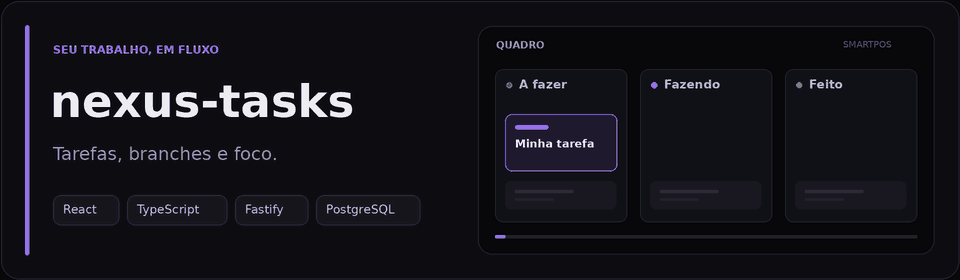

# nexus-tasks

Quadro kanban local para organizar tarefas e branches por repositório.
**React · TypeScript · Fastify · PostgreSQL**

## Recursos

- Tarefas com checklist, prazo, prioridade e etiquetas.
- Quadro, lista, arquivo e busca com filtros.
- Branches com notas, progresso e bloqueio de alterações.
- Movimentação de tarefas por mouse ou teclado.

## Começar

Requisitos: **Node.js 22.22.1**, npm e Docker com Compose.

```bash
npm ci
npm run db:up
npm run db:setup
npm run dev
```

Abra **http://127.0.0.1:5173**. A API usa a porta `3333`.
O setup aplica as migrações e gera o `.env` com uma conta restrita do banco.
As variáveis disponíveis estão em [`.env.example`](.env.example).

Para usar a versão compilada, com o banco configurado e em execução:

```bash
npm run build
npm start
```

Acesse **http://127.0.0.1:3333**.

## Atalhos

`N` cria uma tarefa · `/` busca · `Enter` abre o card · `Espaço` + setas move.
Na criação rápida, use `#stone #sg-pdv` para aplicar etiquetas existentes.

## Comandos úteis

| Comando               | Ação                                               |
| --------------------- | -------------------------------------------------- |
| `npm run db:down`     | Para o banco e preserva os dados.                  |
| `npm run check`       | Verifica código, formatação, build e testes.       |
| `npm run check:api`   | Testa API real isolada e mock.                     |
| `npm run api:mock`    | Inicia o mock sem banco na porta `4010`.           |
| `npm run api:sandbox` | Inicia a API com banco temporário na porta `3334`. |

Os testes da API real e o sandbox precisam de PostgreSQL disponível.

## Saiba mais

[Arquitetura](docs/architecture.md) · [API e Postman](postman/README.md) ·
[Contribuição](CONTRIBUTING.md) · [Segurança](SECURITY.md)

Uso local, sem login. Consulte as orientações de segurança antes de publicar.
